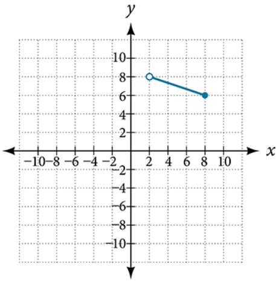

# AVP0049 — Single visual target

MathVerse:439 / MathVerse:482 · different type · Geometric markers

## Shared or similar visual information

An upward arrowhead at the top of a vertical coordinate axis

## Evidence locations

- Left image: A black upward arrowhead sits at the top of the vertical axis, below the letter y.
- Right image: A black upward arrowhead sits at the top of the vertical axis, below the letter y.

## Mathematical meanings

Left image: It indicates the positive y direction and the vertical coordinate axis continuing upward. Right image: It indicates the positive y direction and the vertical coordinate axis continuing upward.

## Same mathematical meanings

yes

## Rationales

Although one image is a unit-circle diagram and the other a function graph, the axis-end arrowheads have the same coordinate-direction meaning.

Only the selected target is annotated. AI visual-review draft; not independently double-annotated by humans.
