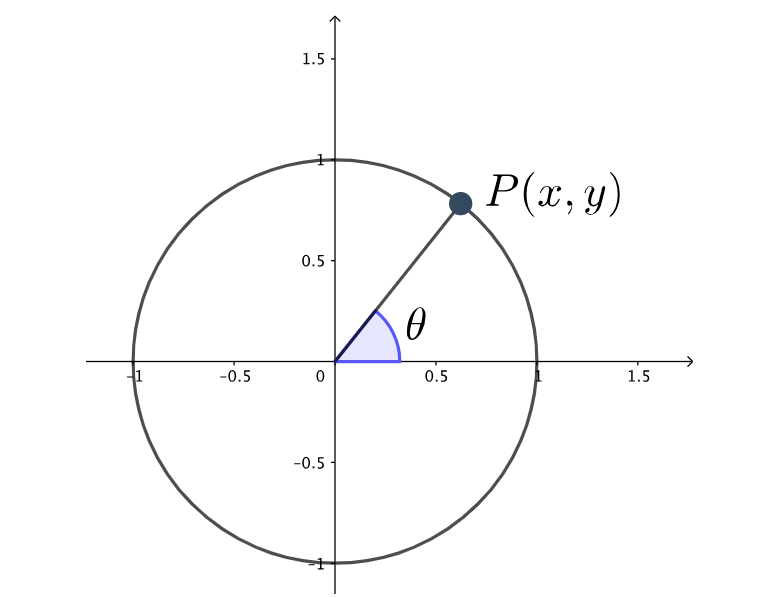
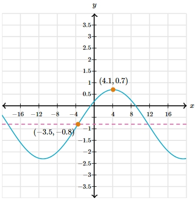

# AVP0050 — Single visual target

MathVerse:449 / MathVerse:533 · different type · Geometric markers

## Shared or similar visual information

A short vertical stroke marking a reading position on the positive horizontal axis

## Evidence locations

- Left image: A short vertical stroke sits above the label 0.5 on the positive x-axis.
- Right image: A short vertical stroke sits above the label 4 on the positive x-axis.

## Mathematical meanings

Left image: It is a reading tick on the horizontal coordinate axis, marking a horizontal-coordinate position. Right image: It is a reading tick on the horizontal coordinate axis, marking a horizontal-coordinate position.

## Same mathematical meanings

yes

## Rationales

This item concerns the reading function of a short tick, rather than the specific value at its position; the two ticks have the same local function.

Only the selected target is annotated. AI visual-review draft; not independently double-annotated by humans.
