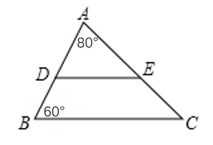
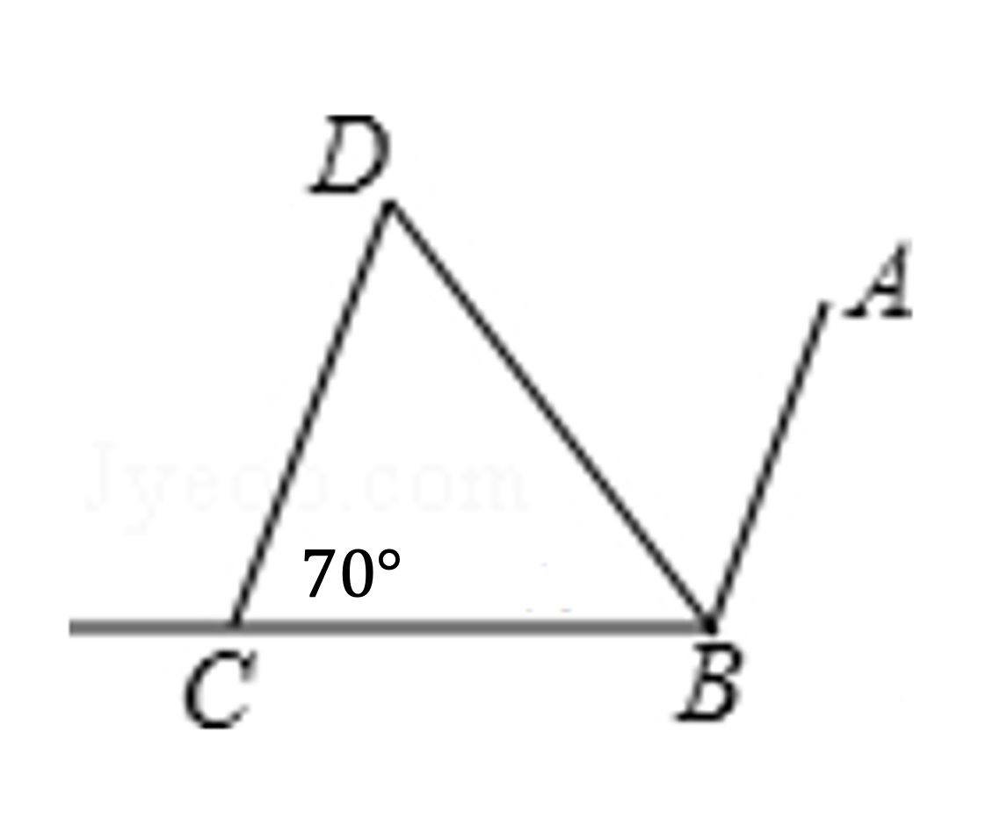

# AVP0051 — Single visual target

MathVerse:1 / MathVerse:3 · same type · Mathematical roles of symbols

## Shared or similar visual information

The uppercase letter A

## Evidence locations

- Left image: A at the top vertex of the triangle
- Right image: A at the upper endpoint of the slanted line on the right

## Mathematical meanings

Left image: A names the upper vertex of the main triangle. Right image: A names the endpoint of the slanted line on the right.

## Same mathematical meanings

yes

## Rationales

The target is the use of a letter as a point name. Differences in position and connectivity do not change that naming function.

Only the selected target is annotated. AI visual-review draft; not independently double-annotated by humans.
