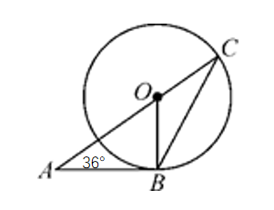
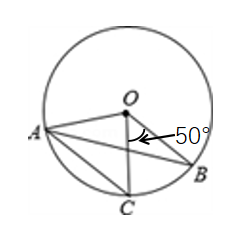

# AVP0052 — Single visual target

MathVerse:4 / MathVerse:16 · same type · Mathematical roles of symbols

## Shared or similar visual information

The uppercase letter O beside an interior point of a circle

## Evidence locations

- Left image: O beside the black point inside the circle
- Right image: O beside the black point inside the circle

## Mathematical meanings

Left image: O names the center of the circle, from which the drawn segments extend to the circumference. Right image: O names the center of the circle, from which the drawn segments extend to the circumference.

## Same mathematical meanings

yes

## Rationales

Both diagrams use O as a circle-center name; this does not identify the two circles as the same object.

Only the selected target is annotated. AI visual-review draft; not independently double-annotated by humans.
