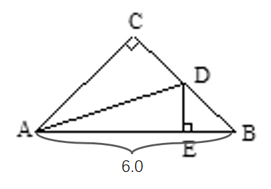
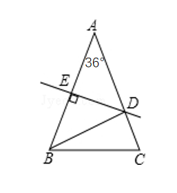

# AVP0053 — Single visual target

MathVerse:9 / MathVerse:10 · same type · Mathematical roles of symbols

## Shared or similar visual information

The uppercase letter D on a sloping side

## Evidence locations

- Left image: D on the right sloping side of the main triangle
- Right image: D on the right sloping side of the main triangle

## Mathematical meanings

Left image: D names a point on the right sloping side of the triangle. Right image: D names a point on the right sloping side of the triangle.

## Same mathematical meanings

yes

## Rationales

The selected letters identify points on sloping sides; their other auxiliary connections need not match.

Only the selected target is annotated. AI visual-review draft; not independently double-annotated by humans.
