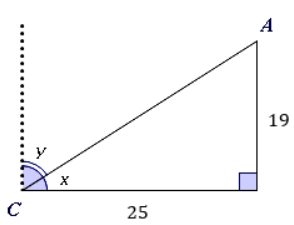

# AVP0054 — Single visual target

MathVerse:346 / MathVerse:349 · same type · Mathematical roles of symbols

## Shared or similar visual information

The lowercase letter x

## Evidence locations

- Left image: x beside the angle arc between the slanted line and horizontal base at C
- Right image: x beside the angle arc between the top horizontal dotted line and diagonal at B

## Mathematical meanings

Left image: x denotes an unknown angle measure at C. Right image: x denotes an unknown angle measure at B.

## Same mathematical meanings

yes

## Rationales

Both occurrences are angle variables. Neither unknown angle is calculated, and their numerical equality is not asserted.

Only the selected target is annotated. AI visual-review draft; not independently double-annotated by humans.
