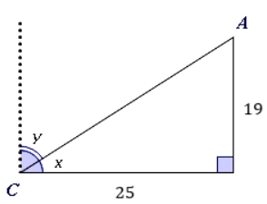
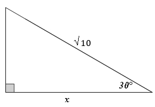

# AVP0055 — Single visual target

MathVerse:346 / MathVerse:374 · same type · Mathematical roles of symbols

## Shared or similar visual information

The lowercase letter x

## Evidence locations

- Left image: x between the slanted line and horizontal base at C
- Right image: x below the horizontal base of the right triangle

## Mathematical meanings

Left image: x denotes the unknown angle at C. Right image: x denotes the unknown length of the horizontal base.

## Same mathematical meanings

no

## Rationales

The same letter is attached to an angle in one image and a segment length in the other.

Only the selected target is annotated. AI visual-review draft; not independently double-annotated by humans.
