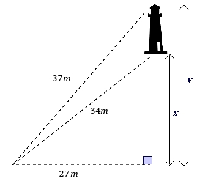

# AVP0056 — Single visual target

MathVerse:349 / MathVerse:366 · same type · Mathematical roles of symbols

## Shared or similar visual information

The lowercase letter y

## Evidence locations

- Left image: y beside the angle arc between the left vertical side and diagonal at B
- Right image: y beside the longer vertical dimension line on the right of the lighthouse diagram

## Mathematical meanings

Left image: y denotes an unknown angle measure at B. Right image: y denotes the overall height indicated by the longer vertical dimension line.

## Same mathematical meanings

no

## Rationales

The letter is attached to an angle arc on the left and a vertical height dimension on the right.

Only the selected target is annotated. AI visual-review draft; not independently double-annotated by humans.
