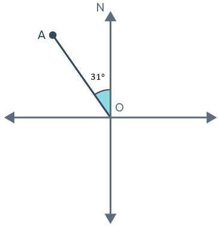

# AVP0057 — Single visual target

MathVerse:331 / MathVerse:336 · same type · Mathematical roles of symbols

## Shared or similar visual information

The uppercase letter N beside an upward vertical direction

## Evidence locations

- Left image: N at the top of the vertical line above A
- Right image: N at the top of the vertical arrow above O

## Mathematical meanings

Left image: N identifies the upward reference direction as north. Right image: N identifies the upward reference direction as north.

## Same mathematical meanings

yes

## Rationales

Both occurrences are direction labels, rather than length or angle variables.

Only the selected target is annotated. AI visual-review draft; not independently double-annotated by humans.
