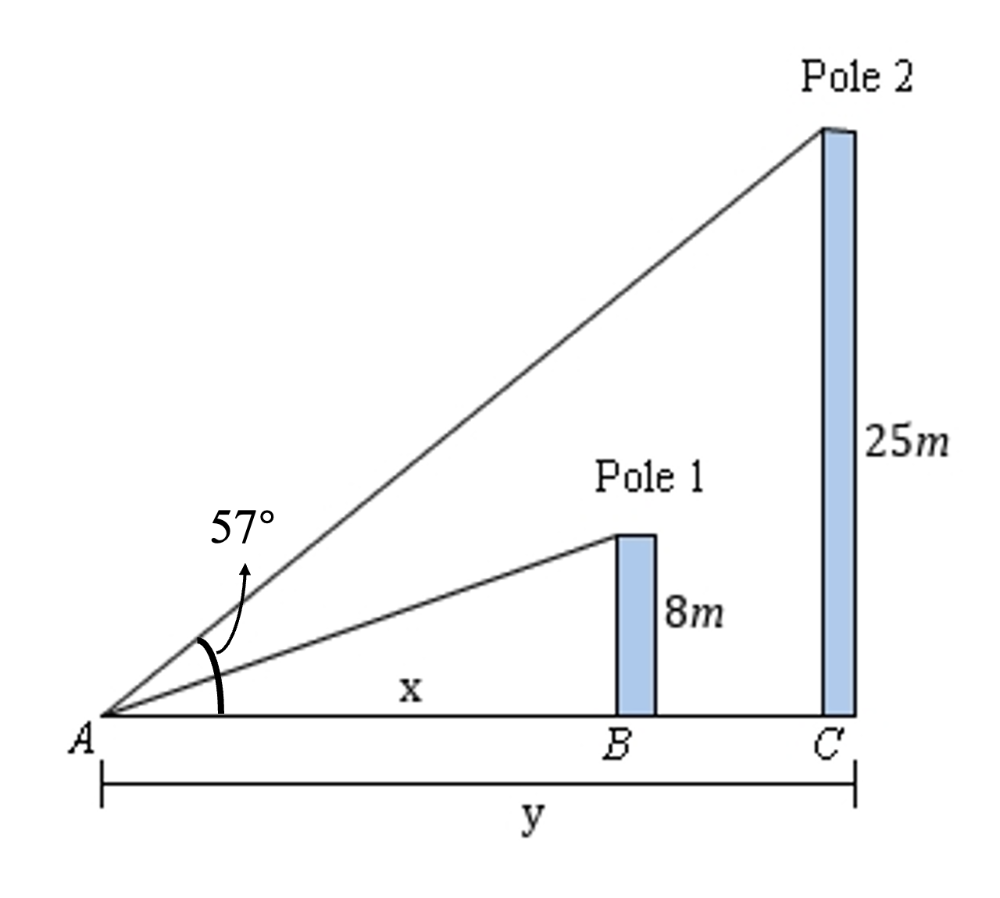

# AVP0058 — Single visual target

MathVerse:351 / MathVerse:359 · same type · Mathematical roles of symbols

## Shared or similar visual information

The lowercase letter x in a horizontal distance annotation

## Evidence locations

- Left image: x marking the horizontal distance from A to B at the bottom
- Right image: x beside part of the horizontal base at the lower right

## Mathematical meanings

Left image: x denotes the unknown length of the indicated horizontal distance. Right image: x denotes the unknown length of the indicated horizontal segment.

## Same mathematical meanings

yes

## Rationales

Both are horizontal length variables; equality of the two unknown lengths is not asserted.

Only the selected target is annotated. AI visual-review draft; not independently double-annotated by humans.
