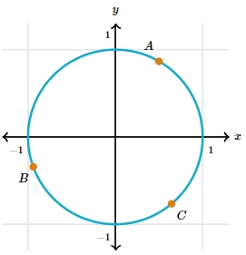

# AVP0059 — Single visual target

MathVerse:439 / MathVerse:525 · same type · Mathematical roles of symbols

## Shared or similar visual information

The uppercase letter A beside a circular arc or circumference

## Evidence locations

- Left image: A beside the magenta point in the first quadrant
- Right image: A beside the orange point in the first quadrant

## Mathematical meanings

Left image: A names the highlighted point on the circular arc. Right image: A names the highlighted point on the circumference.

## Same mathematical meanings

yes

## Rationales

Both occurrences name a designated point on a circle; other auxiliary structures are outside this target.

Only the selected target is annotated. AI visual-review draft; not independently double-annotated by humans.
