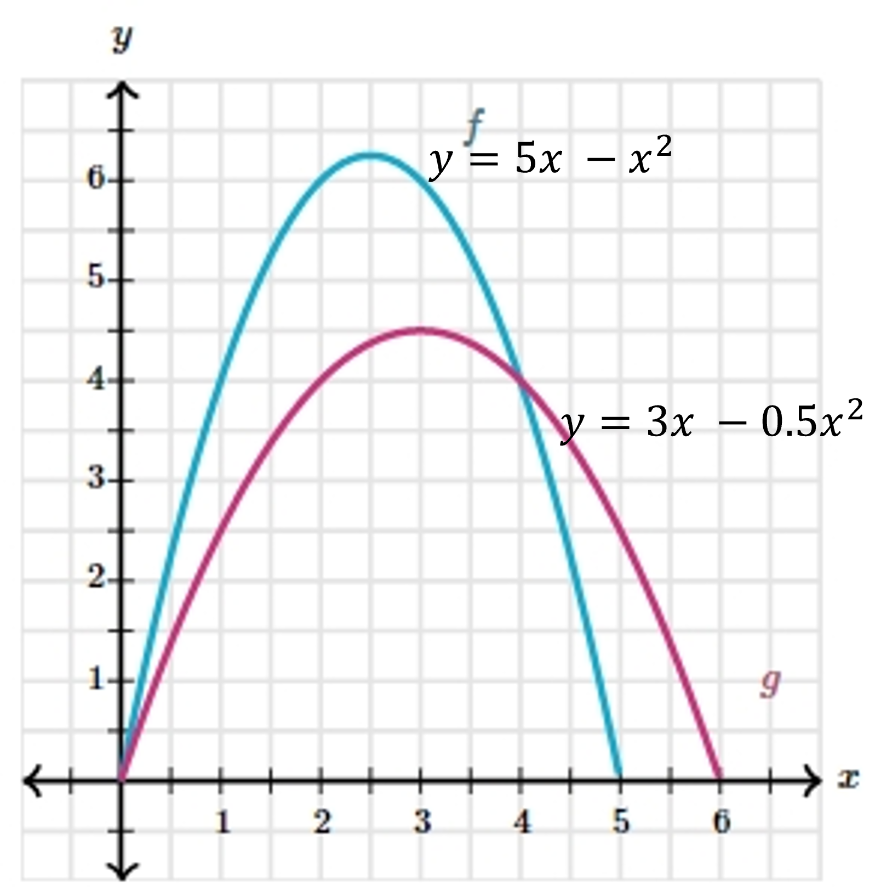
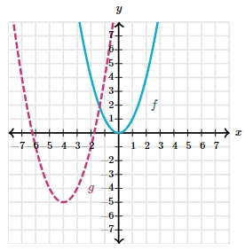

# AVP0060 — Single visual target

MathVerse:519 / MathVerse:568 · same type · Mathematical roles of symbols

## Shared or similar visual information

The lowercase letter f beside a cyan curve

## Evidence locations

- Left image: f near the upper right of the downward-opening cyan curve
- Right image: f near the upward-opening cyan curve

## Mathematical meanings

Left image: f is the name of the function represented by the cyan curve. Right image: f is the name of the function represented by the cyan curve.

## Same mathematical meanings

yes

## Rationales

The comparison concerns the function-naming role of f, without asserting that the two functions or curves are equal.

Only the selected target is annotated. AI visual-review draft; not independently double-annotated by humans.
