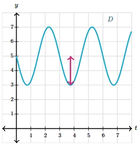

# AVP0061 — Single visual target

MathVerse:544 / MathVerse:545 · same type · Mathematical roles of symbols

## Shared or similar visual information

The uppercase letter D beside a wave-shaped curve

## Evidence locations

- Left image: D near the curve at the upper right
- Right image: D near the curve at the upper right

## Mathematical meanings

Left image: D names the wave-shaped function plotted against the horizontal-axis variable. Right image: D names the wave-shaped function plotted against the horizontal-axis variable.

## Same mathematical meanings

yes

## Rationales

D is a curve or function name in both images, rather than the name of a geometric vertex.

Only the selected target is annotated. AI visual-review draft; not independently double-annotated by humans.
