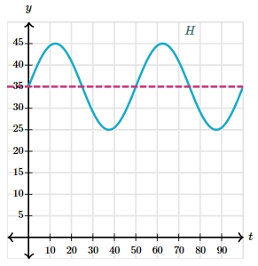

# AVP0062 — Single visual target

MathVerse:546 / MathVerse:548 · same type · Mathematical roles of symbols

## Shared or similar visual information

The uppercase letter H beside a wave-shaped curve

## Evidence locations

- Left image: H near the cyan curve at the upper right
- Right image: H near the cyan curve at the upper right

## Mathematical meanings

Left image: H is the name of the function represented by the wave-shaped curve. Right image: H is the name of the function represented by the wave-shaped curve.

## Same mathematical meanings

yes

## Rationales

Only the naming role of H is compared; amplitudes, periods and numerical function values are outside this target.

Only the selected target is annotated. AI visual-review draft; not independently double-annotated by humans.
