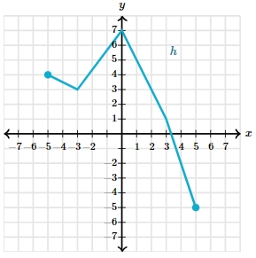
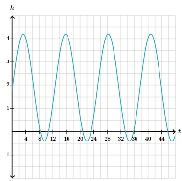

# AVP0063 — Single visual target

MathVerse:558 / MathVerse:549 · same type · Mathematical roles of symbols

## Shared or similar visual information

The lowercase letter h

## Evidence locations

- Left image: h beside the upper-right part of the polyline
- Right image: h at the top of the vertical axis

## Mathematical meanings

Left image: h is the name of the function represented by the entire polyline. Right image: h names the quantity encoded by readings on the vertical axis.

## Same mathematical meanings

no

## Rationales

The letter is attached to a curve in one image and a coordinate axis in the other.

Only the selected target is annotated. AI visual-review draft; not independently double-annotated by humans.
