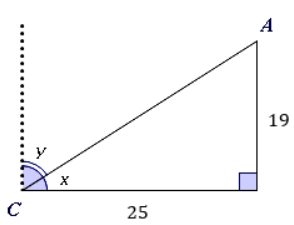

# AVP0064 — Single visual target

MathVerse:346 / MathVerse:493 · different type · Mathematical roles of symbols

## Shared or similar visual information

The lowercase letter x

## Evidence locations

- Left image: x beside the angle arc near the horizontal base at C
- Right image: x at the right end of the horizontal axis of the V-shaped graph

## Mathematical meanings

Left image: x denotes an unknown angle measure. Right image: x names the horizontal coordinate axis, which encodes horizontal position or the independent variable.

## Same mathematical meanings

no

## Rationales

An angle variable and an axis name are distinct contextual uses of the same letter.

Only the selected target is annotated. AI visual-review draft; not independently double-annotated by humans.
