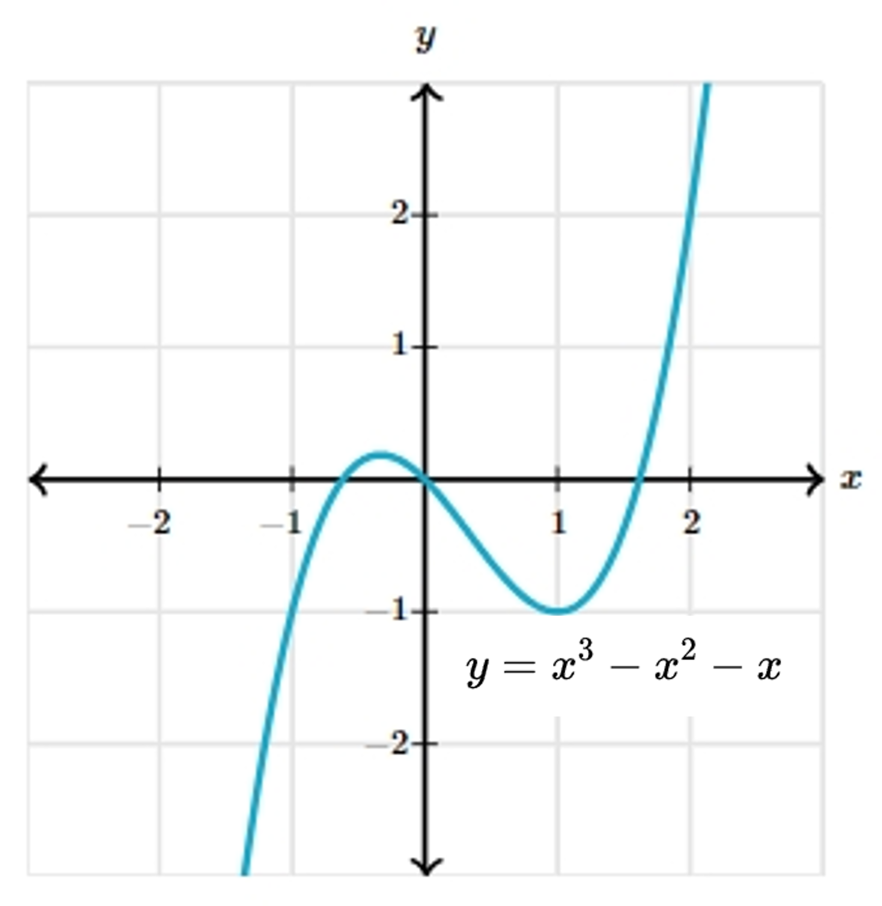

# AVP0065 — Single visual target

MathVerse:349 / MathVerse:521 · different type · Mathematical roles of symbols

## Shared or similar visual information

The lowercase letter y

## Evidence locations

- Left image: y between the left vertical side and diagonal at B
- Right image: y at the top of the vertical axis in the function graph

## Mathematical meanings

Left image: y denotes the unknown measure of the indicated angle. Right image: y names the vertical coordinate axis, which encodes function values.

## Same mathematical meanings

no

## Rationales

The selected letter denotes an angle on the left and a vertical-coordinate or function-value axis on the right.

Only the selected target is annotated. AI visual-review draft; not independently double-annotated by humans.
