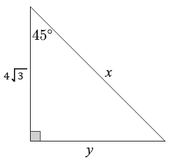
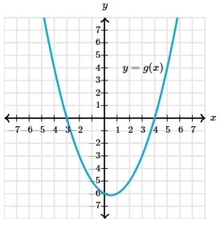

# AVP0066 — Single visual target

MathVerse:375 / MathVerse:575 · different type · Mathematical roles of symbols

## Shared or similar visual information

The lowercase letter x

## Evidence locations

- Left image: x beside the right sloping side of the triangle
- Right image: x at the right end of the horizontal axis in the parabola graph

## Mathematical meanings

Left image: x denotes the unknown length of the hypotenuse. Right image: x names the horizontal axis, representing horizontal coordinates or the function independent variable.

## Same mathematical meanings

no

## Rationales

The same character is attached to a geometric side and a coordinate axis, respectively.

Only the selected target is annotated. AI visual-review draft; not independently double-annotated by humans.
