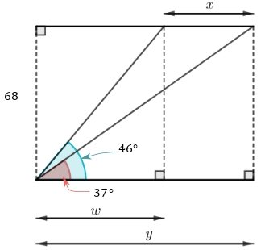
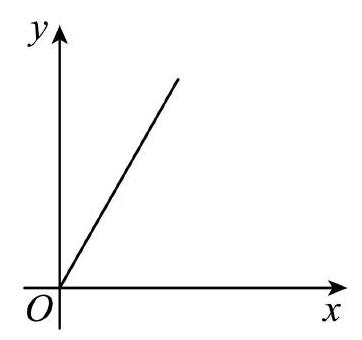

# AVP0067 — Single visual target

MathVerse:358 / MV-MATH:1047_1 · different type · Mathematical roles of symbols

## Shared or similar visual information

The lowercase letter y.

## Evidence locations

- Left image: y on the longest horizontal dimension line below the geometric construction
- Right image: The single y label beside the arrowhead at the top of the vertical axis.

## Mathematical meanings

Left image: y denotes the unknown total horizontal width of the construction. Right image: y names the vertical coordinate axis.

## Same mathematical meanings

no

## Rationales

In the left image, y represents the unknown total horizontal width of the construction. In the right image, y is the name of the vertical coordinate axis.

Only the selected target is annotated. AI visual-review draft; not independently double-annotated by humans.
