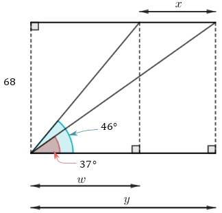
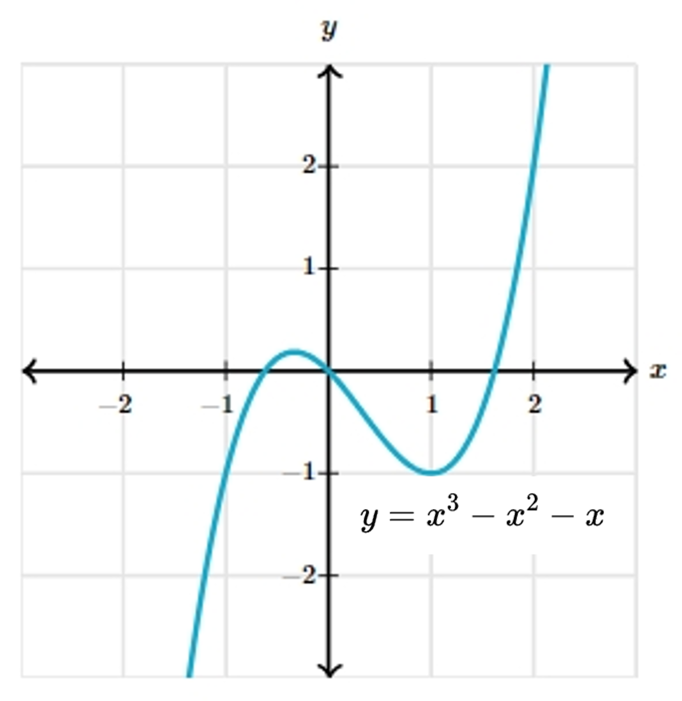

# AVP0067 — Single visual target

MathVerse:358 / MathVerse:521 · different type · Mathematical roles of symbols

## Shared or similar visual information

The lowercase letter y

## Evidence locations

- Left image: y on the longest horizontal dimension line below the geometric construction
- Right image: y on the left-hand side of the formula y = x³ − x² − x

## Mathematical meanings

Left image: y denotes the unknown total horizontal width of the construction. Right image: y denotes the function output determined by x.

## Same mathematical meanings

no

## Rationales

The selected uses are a length dimension and a function output variable.

Only the selected target is annotated. AI visual-review draft; not independently double-annotated by humans.
