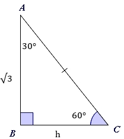
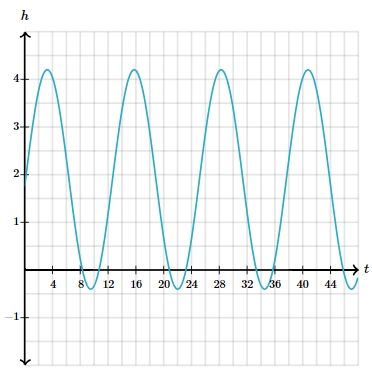

# AVP0068 — Single visual target

MathVerse:369 / MathVerse:549 · different type · Mathematical roles of symbols

## Shared or similar visual information

The lowercase letter h

## Evidence locations

- Left image: h below the horizontal base BC of the right triangle
- Right image: h at the top of the vertical axis in the wave graph

## Mathematical meanings

Left image: h denotes the unknown length of base BC. Right image: h names the quantity encoded vertically in the wave graph.

## Same mathematical meanings

no

## Rationales

One occurrence names a particular side length, while the other names the vertical-coordinate quantity. No unit is inferred for the right image.

Only the selected target is annotated. AI visual-review draft; not independently double-annotated by humans.
