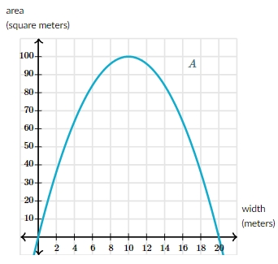

# AVP0069 — Single visual target

MathVerse:331 / MathVerse:574 · different type · Mathematical roles of symbols

## Shared or similar visual information

The uppercase letter A

## Evidence locations

- Left image: A at the lower-right vertex where two lines meet
- Right image: A near the upper-right part of the area-versus-width curve

## Mathematical meanings

Left image: A is the name of a geometric vertex. Right image: A is the name of the area function represented by the curve; the vertical axis is explicitly labeled area.

## Same mathematical meanings

no

## Rationales

A geometric point name and an area-function name have distinct contextual roles.

Only the selected target is annotated. AI visual-review draft; not independently double-annotated by humans.
