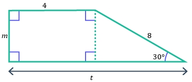

# AVP0070 — Single visual target

MathVerse:379 / MathVerse:544 · different type · Mathematical roles of symbols

## Shared or similar visual information

The lowercase letter t

## Evidence locations

- Left image: t beside the double-headed dimension line spanning the entire base
- Right image: t at the right end of the horizontal axis in the wave graph

## Mathematical meanings

Left image: t denotes the unknown total horizontal length of the geometric figure. Right image: t names the independent variable on the horizontal axis.

## Same mathematical meanings

no

## Rationales

A length-dimension label differs from an independent-variable axis label. The right image does not specify a unit, so no time unit is inferred.

Only the selected target is annotated. AI visual-review draft; not independently double-annotated by humans.
