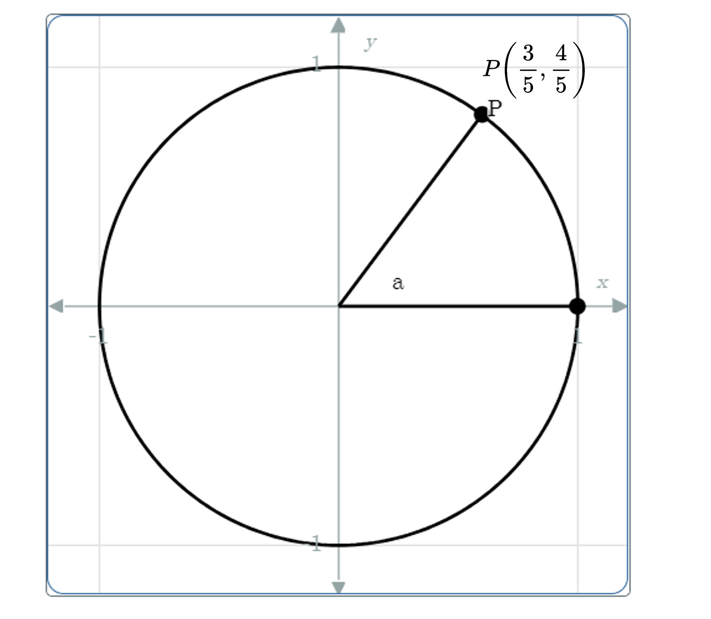
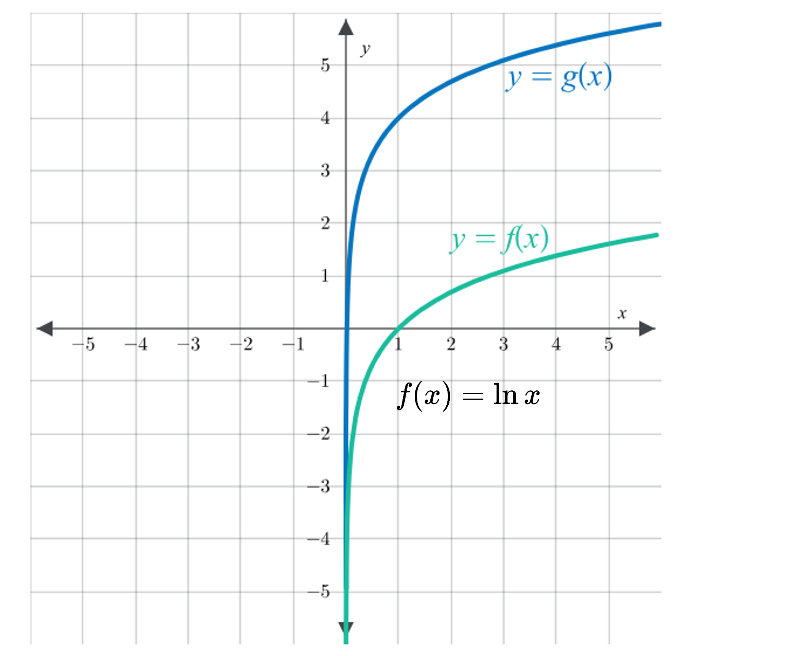

# AVP0071 — Single visual target

MathVerse:441 / MathVerse:588 · different type · Mathematical roles of symbols

## Shared or similar visual information

Parentheses following a name: P(3/5, 4/5) and f(x)

## Evidence locations

- Left image: The parentheses in P(3/5, 4/5) beside point P on the circle
- Right image: The parentheses in f(x) in the formula f(x) = ln x

## Mathematical meanings

Left image: The parentheses enclose the ordered coordinate pair of P, giving its horizontal and vertical coordinates in that order. Right image: The parentheses specify the input x to function f; f(x) denotes its value.

## Same mathematical meanings

no

## Rationales

Ordered-pair notation and function-input notation use similar parentheses for different mathematical purposes.

Only the selected target is annotated. AI visual-review draft; not independently double-annotated by humans.
