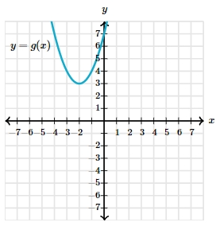

# AVP0072 — Single visual target

MathVerse:437 / MathVerse:564 · different type · Mathematical roles of symbols

## Shared or similar visual information

Parentheses in (−1, 3) and g(x)

## Evidence locations

- Left image: The pair (−1, 3) beside the upper point indicated by the Vertices leader
- Right image: The parentheses in g(x) in the formula y = g(x) at the upper left

## Mathematical meanings

Left image: The two numbers in parentheses form the ordered coordinate pair of the marked upper point. Right image: The x in parentheses is the input variable of function g.

## Same mathematical meanings

no

## Rationales

A two-number coordinate pair differs from notation for a function with one input variable.

Only the selected target is annotated. AI visual-review draft; not independently double-annotated by humans.
