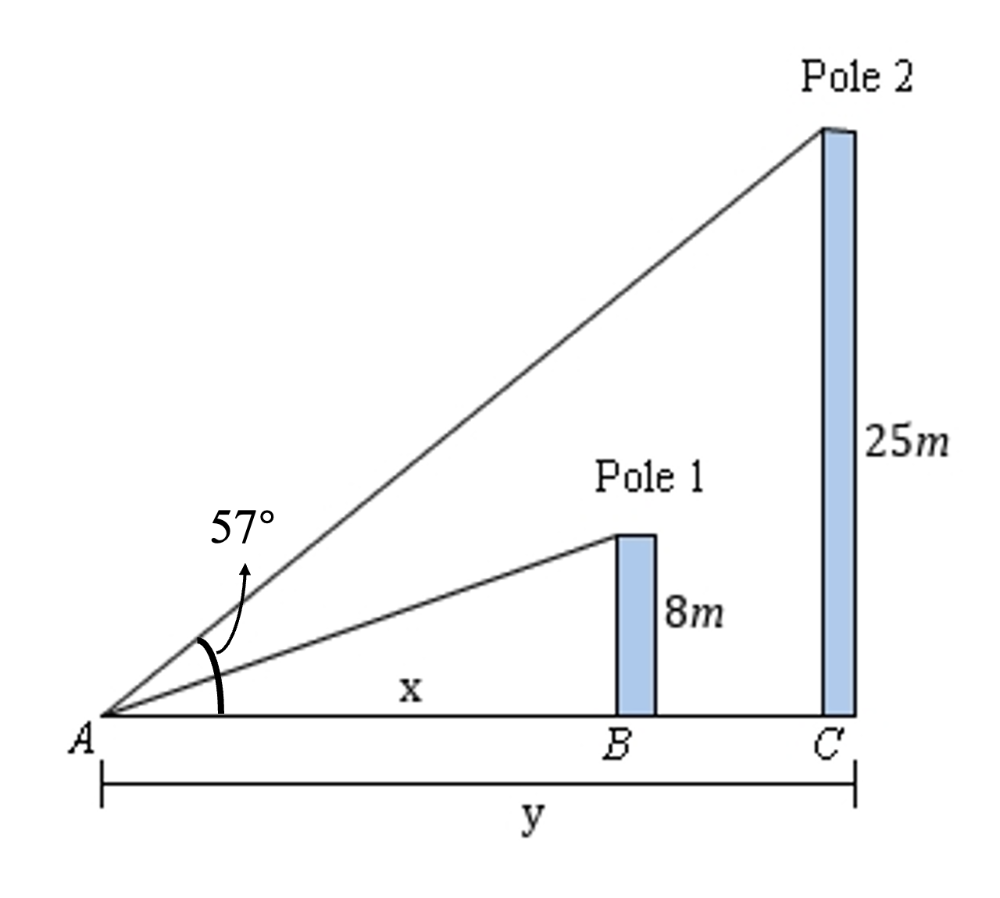
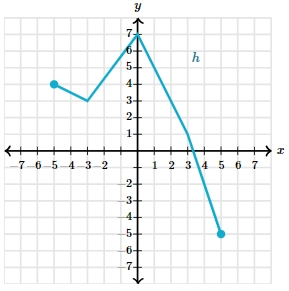

# AVP0073 — Single visual target

MathVerse:351 / MathVerse:558 · different type · Mathematical roles of symbols

## Shared or similar visual information

The lowercase letter x

## Evidence locations

- Left image: x marking the horizontal distance from A to B at the bottom
- Right image: x at the right end of the horizontal axis in the polyline graph

## Mathematical meanings

Left image: x denotes the unknown horizontal distance from A to B. Right image: x names the horizontal coordinate axis, which encodes horizontal position or the independent variable.

## Same mathematical meanings

no

## Rationales

A variable for one specified distance differs from the name of a coordinate axis.

Only the selected target is annotated. AI visual-review draft; not independently double-annotated by humans.
