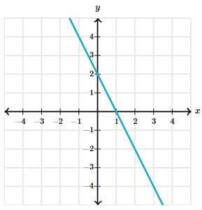

# AVP0074 — Single visual target

MathVerse:439 / MathVerse:591 · different type · Mathematical roles of symbols

## Shared or similar visual information

The lowercase letter x at the right end of a horizontal axis

## Evidence locations

- Left image: x at the right end of the horizontal axis in the circular-arc diagram
- Right image: x at the right end of the horizontal axis in the descending-line graph

## Mathematical meanings

Left image: x names the horizontal coordinate axis and identifies the horizontal-coordinate direction. Right image: x names the horizontal coordinate axis and identifies the horizontal-coordinate direction.

## Same mathematical meanings

yes

## Rationales

The selected axis label retains its coordinate meaning across image types; the principal shapes need not match.

Only the selected target is annotated. AI visual-review draft; not independently double-annotated by humans.
