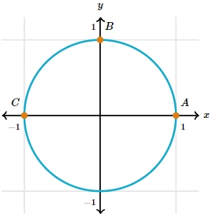
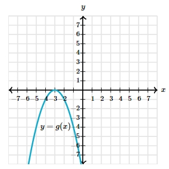

# AVP0075 — Single visual target

MathVerse:528 / MathVerse:563 · different type · Mathematical roles of symbols

## Shared or similar visual information

The lowercase letter y at the top of a vertical axis

## Evidence locations

- Left image: y at the top of the vertical axis in the circle diagram
- Right image: y at the top of the vertical axis in the downward-opening parabola graph

## Mathematical meanings

Left image: y names the vertical coordinate axis and identifies the vertical-coordinate direction. Right image: y names the vertical coordinate axis and identifies the vertical-coordinate direction.

## Same mathematical meanings

yes

## Rationales

The image types differ, but the selected labels encode the same kind of coordinate direction.

Only the selected target is annotated. AI visual-review draft; not independently double-annotated by humans.
