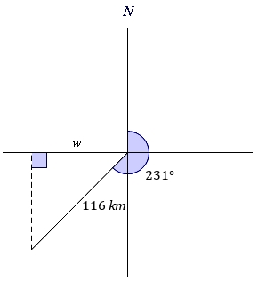

# AVP0076 — Single visual target

MathVerse:354 / MathVerse:345 · same type · Mathematical roles of graphical elements

## Shared or similar visual information

Vertical dashed line

## Evidence locations

- Left image: The black vertical dashed line from B down to C on the horizontal base, with a right-angle box beside C.
- Right image: The black vertical dashed line rising from the lower-left endpoint to the horizontal reference line, with a right-angle box beside its upper end.

## Mathematical meanings

Left image: A geometric auxiliary line that projects a vertex perpendicularly onto the horizontal base. Right image: A geometric auxiliary line that projects the lower endpoint perpendicularly onto the horizontal reference line.

## Same mathematical meanings

yes

## Rationales

Both dashed lines serve as auxiliary lines for perpendicular projection; the particular setting and endpoint names do not change this role.

Only the selected target is annotated. AI visual-review draft; not independently double-annotated by humans.
