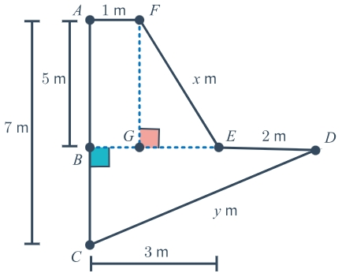

# AVP0077 — Single visual target

MathVerse:368 / MathVerse:359 · same type · Mathematical roles of graphical elements

## Shared or similar visual information

Vertical dotted or dashed line

## Evidence locations

- Left image: The blue vertical dotted line from the upper point F to the middle point G, with a right-angle box beside G.
- Right image: The interior vertical dashed line connecting the upper horizontal dashed line to the lower horizontal line, with a right-angle box at its lower end.

## Mathematical meanings

Left image: A perpendicular auxiliary line projecting an upper point onto a lower horizontal line. Right image: A perpendicular auxiliary line projecting an upper position onto a lower horizontal line.

## Same mathematical meanings

yes

## Rationales

Both broken vertical lines construct perpendicular projections and primarily serve as geometric positioning aids.

Only the selected target is annotated. AI visual-review draft; not independently double-annotated by humans.
