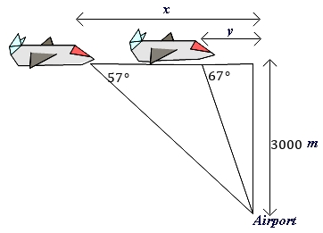
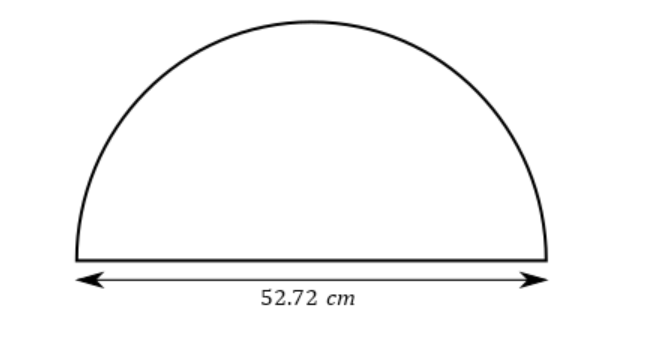

# AVP0078 — Single visual target

MathVerse:352 / MathVerse:402 · same type · Mathematical roles of graphical elements

## Shared or similar visual information

Horizontal line with arrowheads at both ends

## Evidence locations

- Left image: The horizontal line labeled x above the diagram, with an arrowhead at each end.
- Right image: The horizontal line labeled 52.72 cm below the semicircle, with an arrowhead at each end.

## Mathematical meanings

Left image: Indicates an unknown length between two horizontal positions. Right image: Indicates the given length between the left and right endpoints of the semicircle.

## Same mathematical meanings

yes

## Rationales

Both double-headed arrows mark length intervals; whether the length is unknown or given does not change their role as dimension annotations.

Only the selected target is annotated. AI visual-review draft; not independently double-annotated by humans.
