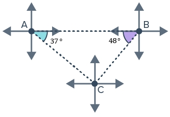
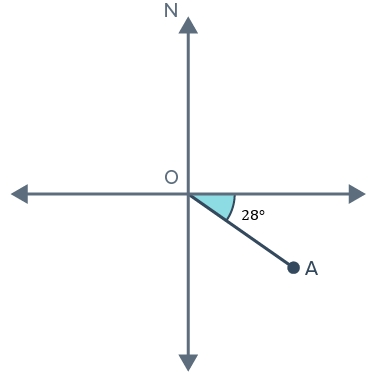

# AVP0079 — Single visual target

MathVerse:337 / MathVerse:334 · same type · Mathematical roles of graphical elements

## Shared or similar visual information

Arrow at the right end of a horizontal reference line

## Evidence locations

- Left image: The right-pointing arrow on the horizontal reference line to the right of A.
- Right image: The right-pointing arrow at the right end of the horizontal reference line through O.

## Mathematical meanings

Left image: Indicates the direction of the horizontal bearing reference line at A. Right image: Indicates the direction of the horizontal bearing reference line at O.

## Same mathematical meanings

yes

## Rationales

Both arrows specify the orientation of bearing reference lines; they are neither parallelism marks nor length-dimension arrows.

Only the selected target is annotated. AI visual-review draft; not independently double-annotated by humans.
