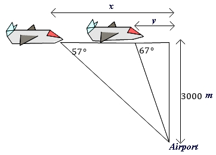
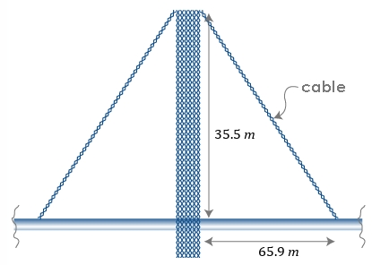

# AVP0080 — Single visual target

MathVerse:352 / MathVerse:364 · same type · Mathematical roles of graphical elements

## Shared or similar visual information

Horizontal line with arrowheads at both ends

## Evidence locations

- Left image: The horizontal double-headed arrow labeled y above the airplanes.
- Right image: The horizontal double-headed arrow labeled 65.9 m below the bridge.

## Mathematical meanings

Left image: Indicates an unknown length between two horizontal positions. Right image: Indicates the given horizontal length between the tower column and the position on its right.

## Same mathematical meanings

yes

## Rationales

Both arrows annotate a length interval; differences in setting and whether the length is known do not change this role.

Only the selected target is annotated. AI visual-review draft; not independently double-annotated by humans.
