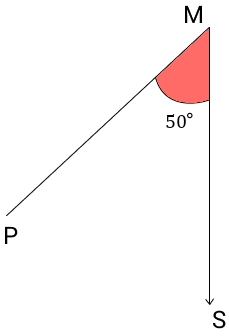
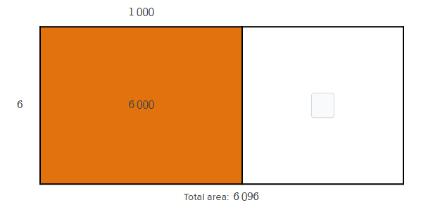

# AVP0081 — Single visual target

MathVerse:332 / MathVerse:421 · same type · Mathematical roles of graphical elements

## Shared or similar visual information

Shaded region

## Evidence locations

- Left image: The small red shaded angle region labeled 50 degrees between the two rays at M.
- Right image: The orange shaded region labeled 6 000 in the left part of the rectangle, with Total area written below the diagram.

## Mathematical meanings

Left image: Highlights the interior of the angle labeled 50 degrees. Right image: Identifies a rectangular subregion measured separately in an area model.

## Same mathematical meanings

no

## Rationales

The left shading annotates an angle, whereas the right shading partitions an area; the presence of shading alone does not imply the same mathematical role.

Only the selected target is annotated. AI visual-review draft; not independently double-annotated by humans.
