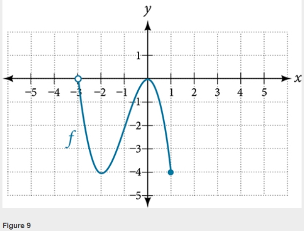
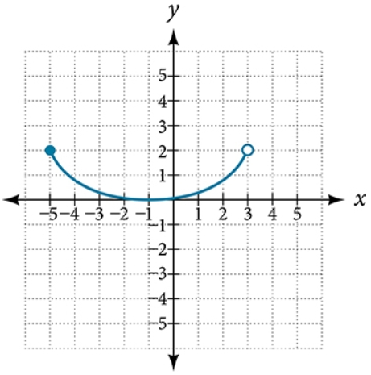

# AVP0082 — Single visual target

MathVerse:481 / MathVerse:484 · same type · Mathematical roles of graphical elements

## Shared or similar visual information

Hollow circle at a curve endpoint

## Evidence locations

- Left image: The hollow circle at the left endpoint of the blue curve, on the horizontal axis near x=-3.
- Right image: The hollow circle at the right endpoint of the blue curve, near (3,2).

## Mathematical meanings

Left image: The hollow endpoint is excluded from the displayed function graph, indicating that the shown function value is not attained at that endpoint. Right image: The hollow endpoint is excluded from the displayed function graph, indicating that the shown function value is not attained at that endpoint.

## Same mathematical meanings

yes

## Rationales

Both hollow endpoints indicate endpoint exclusion. This does not establish that the corresponding vertical-coordinate value is absent from the range of the entire function.

Only the selected target is annotated. AI visual-review draft; not independently double-annotated by humans.
