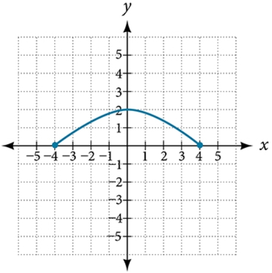
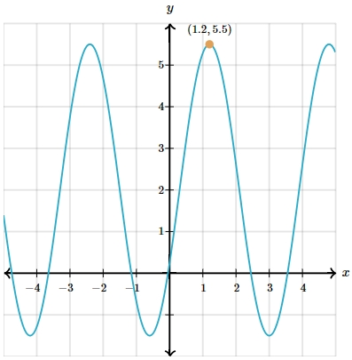

# AVP0083 — Single visual target

MathVerse:483 / MathVerse:531 · same type · Mathematical roles of graphical elements

## Shared or similar visual information

Filled circular marker on a curve

## Evidence locations

- Left image: The blue filled circular marker at the left endpoint of the arch-shaped curve, on the horizontal axis.
- Right image: The orange filled circular marker labeled (1.2,5.5) near a peak of the waveform.

## Mathematical meanings

Left image: A closed-endpoint marker indicating that the left endpoint belongs to this segment of the function graph. Right image: A special-position marker identifying a peak of the waveform whose coordinates can be read.

## Same mathematical meanings

no

## Rationales

The left marker encodes endpoint inclusion, whereas the right marker highlights an interior coordinate position; an interior marker should not be interpreted as a domain endpoint.

Only the selected target is annotated. AI visual-review draft; not independently double-annotated by humans.
