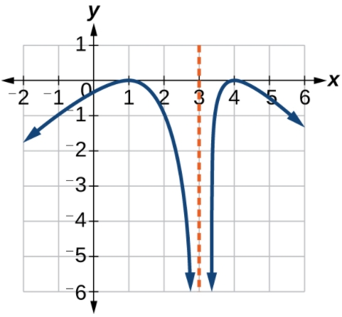
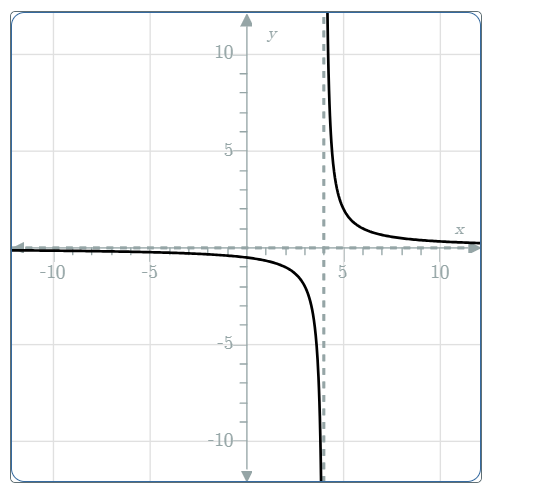

# AVP0084 — Single visual target

MathVerse:489 / MathVerse:582 · same type · Mathematical roles of graphical elements

## Shared or similar visual information

Vertical dashed line separate from the curve

## Evidence locations

- Left image: The orange vertical dashed line at horizontal coordinate 3, between the two blue curve branches.
- Right image: The gray vertical dashed line to the right of the vertical axis, between the two black curve branches.

## Mathematical meanings

Left image: Marks the vertical asymptote approached by the two branches of the function graph. Right image: Marks the vertical asymptote approached by the two branches of the function graph.

## Same mathematical meanings

yes

## Rationales

Both separate vertical dashed lines serve as vertical-asymptote references for function graphs; their horizontal coordinates need not match, and no function formula is derived.

Only the selected target is annotated. AI visual-review draft; not independently double-annotated by humans.
