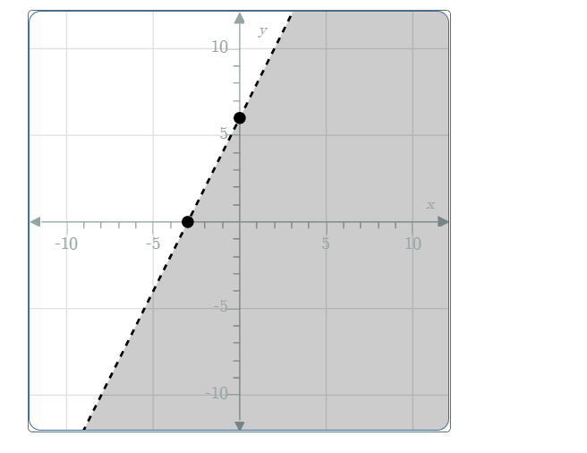

# AVP0085 — Single visual target

MathVerse:511 / MathVerse:568 · same type · Mathematical roles of graphical elements

## Shared or similar visual information

Dashed plotted line

## Evidence locations

- Left image: The black dashed line rising to the right along the boundary of the gray half-plane.
- Right image: The magenta dashed U-shaped curve labeled g.

## Mathematical meanings

Left image: The boundary of an inequality region; the dashes indicate that this boundary is excluded from the displayed solution set. Right image: The graph of a second function g, distinguished from the cyan graph of f.

## Same mathematical meanings

no

## Rationales

The left dashes encode exclusion of a solution-set boundary, whereas the right dashes are a drawing style used to distinguish function graphs.

Only the selected target is annotated. AI visual-review draft; not independently double-annotated by humans.
