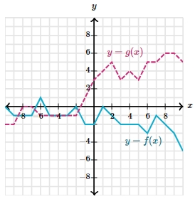

# AVP0086 — Single visual target

MathVerse:535 / MathVerse:557 · same type · Mathematical roles of graphical elements

## Shared or similar visual information

Magenta dashed line

## Evidence locations

- Left image: The magenta horizontal dashed line crossing the cyan waveform and passing through the orange point.
- Right image: The magenta dashed polyline labeled y=g(x).

## Mathematical meanings

Left image: An auxiliary reference line at a fixed vertical level, used to align and read the marked point's vertical coordinate. Right image: The graph of function g, expressing how the vertical coordinate varies with the horizontal coordinate.

## Same mathematical meanings

no

## Rationales

The left line assists coordinate reading, whereas the right line is the function graph being studied; matching color and dash style do not imply matching mathematical roles.

Only the selected target is annotated. AI visual-review draft; not independently double-annotated by humans.
