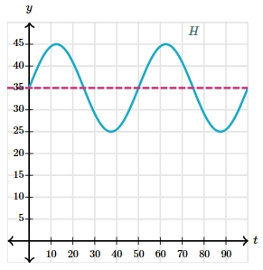
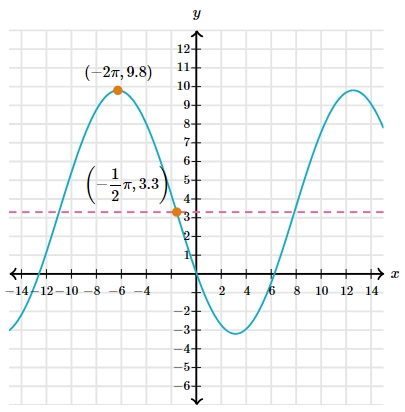

# AVP0087 — Single visual target

MathVerse:548 / MathVerse:542 · same type · Mathematical roles of graphical elements

## Shared or similar visual information

Horizontal dashed line

## Evidence locations

- Left image: The magenta horizontal dashed line at an intermediate height of the cyan waveform, approximately y=35.
- Right image: The magenta horizontal dashed line passing through the orange point labeled (-π/2,3.3).

## Mathematical meanings

Left image: Provides a horizontal comparison reference at a fixed vertical-coordinate level. Right image: Provides a horizontal comparison reference at a fixed vertical-coordinate level.

## Same mathematical meanings

yes

## Rationales

Both show a fixed vertical-coordinate level as a horizontal auxiliary reference; their numerical heights need not match, and no midline is calculated from them.

Only the selected target is annotated. AI visual-review draft; not independently double-annotated by humans.
