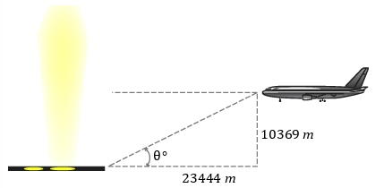
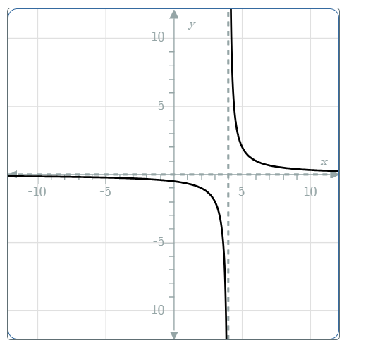

# AVP0089 — Single visual target

MathVerse:365 / MathVerse:582 · different type · Mathematical roles of graphical elements

## Shared or similar visual information

Vertical dashed line

## Evidence locations

- Left image: The vertical dashed line below the airplane connecting its position to the horizontal ground line, labeled 10369 m.
- Right image: The gray vertical dashed line to the right of the vertical axis, between the two black curve branches.

## Mathematical meanings

Left image: Represents the airplane's height projected onto horizontal ground, serving as a geometric height auxiliary line. Right image: A vertical-asymptote reference for the function graph.

## Same mathematical meanings

no

## Rationales

The geometric projection line connects positions in a finite construction, whereas the function-diagram line marks asymptotic behavior; their roles differ.

Only the selected target is annotated. AI visual-review draft; not independently double-annotated by humans.
