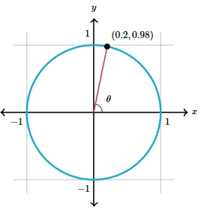

# AVP0090 — Single visual target

MathVerse:556 / MathVerse:535 · different type · Mathematical roles of graphical elements

## Shared or similar visual information

Filled circular marker with a coordinate annotation

## Evidence locations

- Left image: The black filled circular marker on the upper-right part of the circle, beside (0.2,0.98).
- Right image: The orange filled circular marker on a descending part of the waveform, beside (2π/3,1.2).

## Mathematical meanings

Left image: Locates and marks a point with given coordinates on the circle. Right image: Locates and marks a point with given coordinates on the function graph.

## Same mathematical meanings

yes

## Rationales

The shared meaning concerns the role of identifying a designated point by its coordinates; the angle's terminal side on the left and the curve's trend on the right are outside this comparison.

Only the selected target is annotated. AI visual-review draft; not independently double-annotated by humans.
