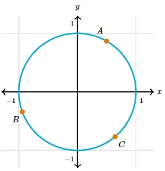
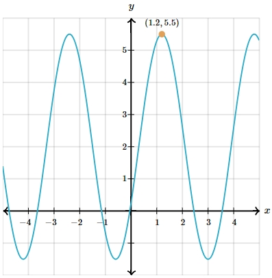

# AVP0091 — Single visual target

MathVerse:525 / MathVerse:531 · different type · Mathematical roles of graphical elements

## Shared or similar visual information

Filled circular marker on a curve

## Evidence locations

- Left image: The orange filled circular marker beside A on the upper-right part of the unit circle.
- Right image: The orange filled circular marker beside (1.2,5.5) at a peak of the waveform.

## Mathematical meanings

Left image: Highlights a designated position on a geometric curve. Right image: Highlights a designated position on a function curve.

## Same mathematical meanings

yes

## Rationales

This comparison concerns only their shared role as position markers away from endpoints; A on the circle and the waveform peak are not treated as the same object, and extremum-related meaning is not additionally compared.

Only the selected target is annotated. AI visual-review draft; not independently double-annotated by humans.
