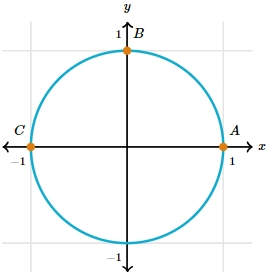
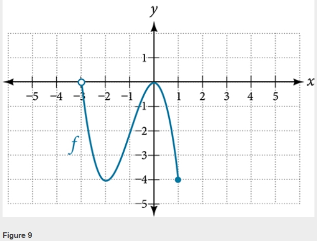

# AVP0092 — Single visual target

MathVerse:528 / MathVerse:481 · different type · Mathematical roles of graphical elements

## Shared or similar visual information

Filled circular marker

## Evidence locations

- Left image: The orange filled circular marker beside A at the rightmost point of the circle.
- Right image: The blue filled circular marker at the lower-right endpoint of the blue function curve.

## Mathematical meanings

Left image: Names and locates a designated position on the complete circle. Right image: A closed-endpoint marker indicating that the function graph includes this boundary point.

## Same mathematical meanings

no

## Rationales

The position marker on a complete circle does not indicate a domain cutoff, whereas the filled style at the function endpoint encodes inclusion of that endpoint.

Only the selected target is annotated. AI visual-review draft; not independently double-annotated by humans.
