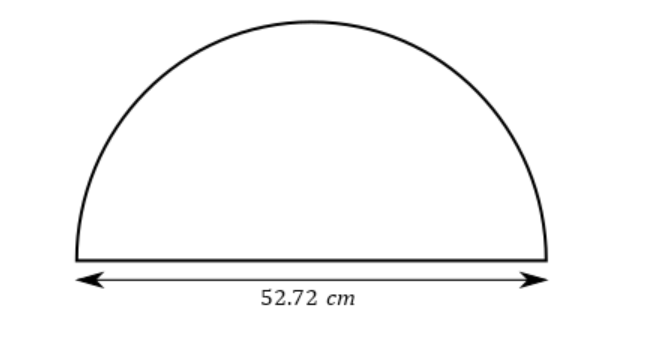

# AVP0093 — Single visual target

MathVerse:402 / MathVerse:544 · different type · Mathematical roles of graphical elements

## Shared or similar visual information

Horizontal double-headed arrow

## Evidence locations

- Left image: The horizontal double-headed arrow below the semicircle and above 52.72 cm.
- Right image: The magenta horizontal double-headed arrow between two adjacent peaks of the waveform.

## Mathematical meanings

Left image: Indicates a spatial-length interval between two horizontal positions. Right image: Indicates the interval between two adjacent peaks along the horizontal independent-variable axis, representing one repetition period of the displayed waveform.

## Same mathematical meanings

no

## Rationales

The left arrow measures spatial length, whereas the right arrow marks a waveform repetition interval. Their specific mathematical roles differ; a time unit is not inferred merely because the horizontal axis is labeled t.

Only the selected target is annotated. AI visual-review draft; not independently double-annotated by humans.
