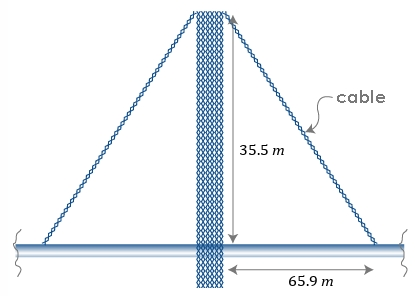

# AVP0094 — Single visual target

MathVerse:364 / MathVerse:546 · different type · Mathematical roles of graphical elements

## Shared or similar visual information

Horizontal double-headed arrow

## Evidence locations

- Left image: The double-headed arrow below the bridge beside 65.9 m, connecting the tower column and a position on its right.
- Right image: The magenta double-headed arrow above the waveform between two adjacent peaks.

## Mathematical meanings

Left image: Indicates the horizontal distance from the tower column to the position on its right. Right image: Indicates the horizontal-coordinate interval between adjacent waveform peaks, representing one repetition period.

## Same mathematical meanings

no

## Rationales

A geometric distance dimension and a waveform period have different specific mathematical roles, although both use double-headed arrows to mark intervals.

Only the selected target is annotated. AI visual-review draft; not independently double-annotated by humans.
