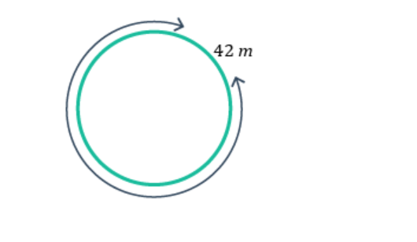
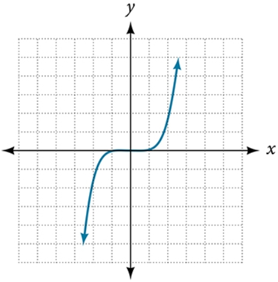

# AVP0095 — Single visual target

MathVerse:391 / MathVerse:477 · different type · Mathematical roles of graphical elements

## Shared or similar visual information

Arrow at the end of a curved line

## Evidence locations

- Left image: The gray curved arrow following the outside of the green circle.
- Right image: The arrow at the upper-right end of the blue S-shaped function curve.

## Mathematical meanings

Left image: Indicates the measured length around one complete circumference. Right image: Indicates that the open function curve continues beyond the displayed area.

## Same mathematical meanings

no

## Rationales

The left arrow traces the extent around a closed circumference, whereas the right arrow shows that the function curve does not terminate at the plotting boundary.

Only the selected target is annotated. AI visual-review draft; not independently double-annotated by humans.
