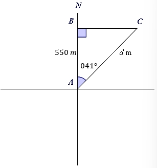
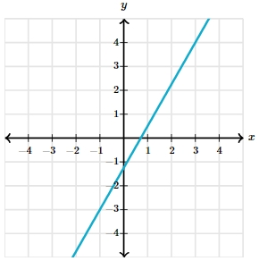

# AVP0096 — Single visual target

MathVerse:426 / MathVerse:592 · different type · Mathematical roles of graphical elements

## Shared or similar visual information

Straight segment sloping upward to the right

## Evidence locations

- Left image: The straight segment from the lower point A to the upper-right point C, labeled d m.
- Right image: The cyan straight line extending upward to the right across the coordinate grid.

## Mathematical meanings

Left image: The hypotenuse of a right triangle, with its length denoted by d. Right image: A straight-line graph representing a function or variable relationship.

## Same mathematical meanings

no

## Rationales

The left segment is an edge of a geometric object, whereas the right line is a function graph; similar slopes do not give them the same mathematical role.

Only the selected target is annotated. AI visual-review draft; not independently double-annotated by humans.
