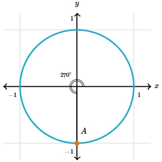
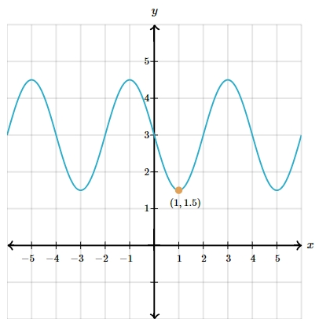

# AVP0097 — Single visual target

MathVerse:524 / MathVerse:541 · different type · Mathematical roles of graphical elements

## Shared or similar visual information

Cyan curve

## Evidence locations

- Left image: The complete cyan circle enclosing the coordinate origin and passing through A.
- Right image: The cyan curve that oscillates across the coordinate system and passes through the orange point.

## Mathematical meanings

Left image: The circular boundary of the geometric object known as the unit circle. Right image: A function graph using horizontal and vertical positions to express a relationship between variables.

## Same mathematical meanings

no

## Rationales

The anchor is the main cyan curve, which serves as a geometric boundary on the left and a function graph on the right; color or curved appearance is not used to establish function equivalence.

Only the selected target is annotated. AI visual-review draft; not independently double-annotated by humans.
