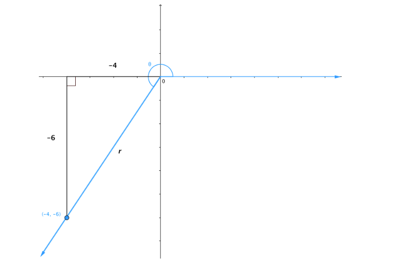

# AVP0098 — Single visual target

MathVerse:458 / MathVerse:493 · different type · Mathematical roles of graphical elements

## Shared or similar visual information

Horizontal coordinate axis with tick marks

## Evidence locations

- Left image: The horizontal axis through the origin labeled 0 and the tick labeled -4; its positive half is drawn as a blue line with an arrow.
- Right image: The black horizontal axis labeled x, with ticks and arrows, crossing the V-shaped function graph.

## Mathematical meanings

Left image: Provides a horizontal-coordinate reference through tick marks and orientation. Right image: Provides a horizontal-coordinate reference through tick marks and orientation.

## Same mathematical meanings

yes

## Rationales

Both are horizontal coordinate axes; drawing a geometric construction on one and a function graph on the other does not change the role of the axis.

Only the selected target is annotated. AI visual-review draft; not independently double-annotated by humans.
